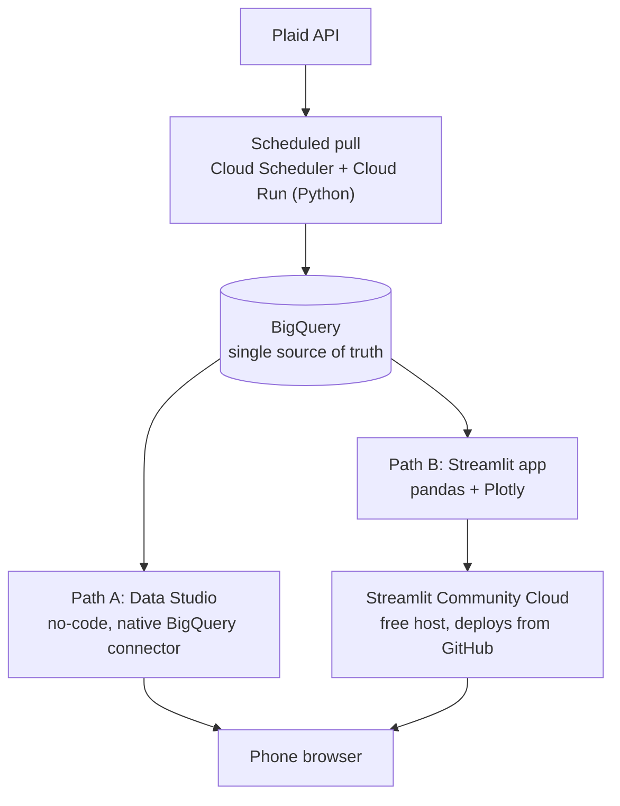

# rc_financetracker: Plaid → BigQuery → Dashboard
Building a basic finance tracker data pipeline, from Plaid to basic BI interfaces. A simple, near-free personal finance pipeline built to practice data / analytics engineering. It replaces an earlier over-built, vibe-coded version (FastAPI + SQLite + custom auth/encryption + Streamlit).

## Goals

- Pull bank/credit card transactions from the Plaid API on a schedule
- Store them in a cheap, relational warehouse (BigQuery)
- Total spent per day, week, and month **including pending** (total $ swiped)
- Total **posted** per day, week, and month
- Control over charts (line, pie) using my own vendor classifications (add a small `vendor_map` table: `merchant_name` → my category)
- View it all on my desktop AND phone
- Keep cost at or near $0
- Practice work/career related skills

## Architecture

Both paths read the same BigQuery tables, so Path A can be built first and Path B added later with no pipeline changes.

| | Path A: Data Studio | Path B: Streamlit |
|---|---|---|
| Effort | Low, drag-and-drop | Higher, Python code |
| Learning value | BI tool skills | pandas cleanup + Plotly |
| Phone | Responsive in mobile browser | Open the app URL in mobile browser |
| Watch out for | Little cleanup practice | Needs a privacy gate (bank data behind a URL); idle apps sleep |

## Build order

1. Create a GCP project and enable BigQuery, Cloud Run, and Cloud Scheduler APIs
2. Set a **billing budget alert** before anything else
3. Create the dataset and the 3 tables above 
4. Write and test the Plaid → BigQuery script locally (Plaid sandbox first)
5. Deploy it as a Cloud Run job; trigger twice daily with Cloud Scheduler
6. Path A: connect Data Studio to BigQuery and build the first charts
   Path B (optional): Streamlit app reading from BigQuery, deployed to Streamlit Community Cloud
7. Later: add a raw-file archive (GCS bucket, JSON or Iceberg) before BigQuery for redundancy

## Cost notes (verify current limits before relying on them)

- BigQuery: free tier with a monthly query allowance (1 TB) and a small free storage allowance; personal transaction data is tiny.
- Cloud Run and Cloud Scheduler: small free allowances, more than enough for 2 runs/day.
- Data Studio: free. Streamlit Community Cloud: free.
- GitHub Actions is an alternative scheduler (about 2,000 free minutes/month), but scheduled runs can be delayed, and one source says private repos on free plans may not run scheduled workflows.

## Security

- Never commit Plaid keys or GCP credentials; use Secret Manager or environment variables.
- Restrict access to any dashboard that shows real transactions.
